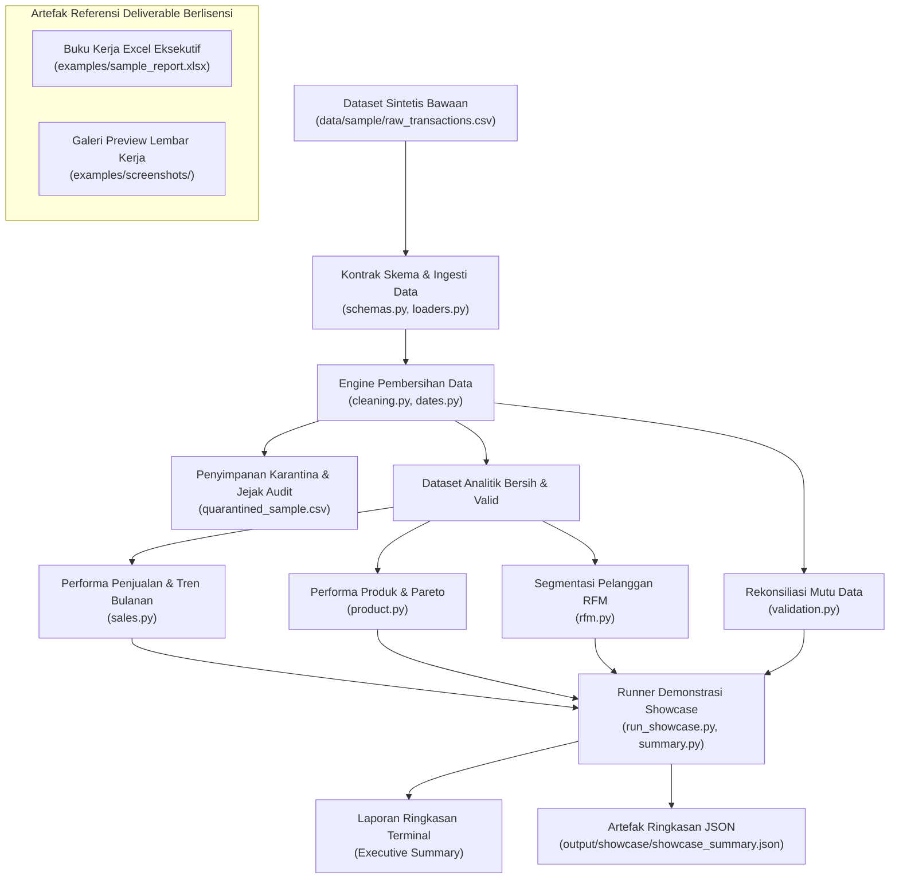

# UMKM Retail Analytics — Showcase Teknis

[](https://www.python.org/)
[](tests/)
[](examples/sample_report.xlsx)
[](#13-pemberitahuan-hak-cipta--lisensi)

> **Mendemonstrasikan penerapan teknik praktis Python untuk higienitas data ritel, analitik bisnis, dan pelaporan eksekutif.**

---

## 1. Ringkasan Proyek

**UMKM Retail Analytics Technical Showcase** adalah repositori portofolio teknis publik yang mendemonstrasikan bagaimana prinsip rekayasa data (*data engineering*) dan analitik bisnis ritel modern diimplementasikan secara terstruktur dan bersih menggunakan Python.

Pada operasional bisnis ritel kecil dan menengah (UMKM, minimarket, toko grosir sembako, dan toko mandiri), pencatatan transaksi kasir sering kali berantakan dan terfragmentasi di berbagai ekspor mesin POS, catatan manual kasir, serta aplikasi perpesanan. Masalah umum meliputi format tanggal yang tidak seragam, penulisan kode SKU yang acak, baris ganda (*exact duplicates*), ketiadaan identitas member, dan nilai angka yang cacat.

Showcase ini mendemonstrasikan:
1. **Ingesti Data Defensif**: Penegakan kontrak skema data (*schema contracts*) dengan ketahanan pembacaan enkoding UTF-8, UTF-8-BOM, dan Latin-1.
2. **Higienitas Data Deterministik**: Parsing format tanggal ambigu (ISO vs. format tanggal Indonesia `DD/MM/YYYY`), validasi integritas finansial, serta pengalihan baris transaksi yang tidak valid ke penyimpanan karantina (*quarantine storage*).
3. **Analitik Bisnis Ritel Murni**: Perhitungan matematis KPI penjualan, konsentrasi katalog Pareto (80/20), segmentasi perilaku pelanggan RFM (Recency, Frequency, Monetary), kecepatan perputaran stok (*inventory velocity*), dan keterkaitan keranjang belanja (*market basket affinity*).
4. **Prinsip Rekonsiliasi Data Lengkap**: Jaminan matematis bahwa seluruh data yang masuk dapat dipertanggungjawabkan ($\text{Input} = \text{Diterima} + \text{Dikarantina} + \text{Duplikat}$).
5. **Artefak Pelaporan Eksekutif Referensi**: Buku kerja Excel 8-lembar kerja lengkap ([`examples/sample_report.xlsx`](examples/sample_report.xlsx)) yang telah selesai dibangun sebagai percontohan kualitas deliverable bisnis bacadataku.

---

## 2. Masalah Bisnis yang Didemonstrasikan

Pemilik usaha ritel sering kali membuat keputusan pengadaan barang, penetapan harga promo, dan strategi loyalitas tanpa visibilitas objektif terhadap mekanika penjualan:

- **Kerancuan Omzet vs Laba**: Pemilik sering kali menyamakan omzet transaksi kotor (*top-line turnover*) dengan laba bersih atau arus kas riil, sehingga tidak menyadari jika produk berpenjualan tinggi justru mengalami kerugian margin.
- **Titik Buta Konsentrasi Produk (Pareto)**: Produk bernilai rupiah tinggi (seperti Beras 5kg atau Minyak Goreng 2L) menyumbang volume omzet terbesar, sedangkan produk bernilai kecil (camilan, mi instan) menyumbang frekuensi perputaran unit di rak. Tanpa pemisahan Pareto objektif, peritel kesulitan mengatur alokasi modal kerja.
- **Ketiadaan Visibilitas Retensi Pelanggan**: Pemilik toko jarang mengetahui pelanggan mana yang setia berkunjung rutin vs pelanggan bernilai belanja besar yang sudah lama tidak kembali (*at-risk*).
- **Ketidakpastian Pemesanan Ulang Stok**: Tanpa analisis kecepatan jual harian (*daily run-rate*), toko kerap mengalami kekosongan barang (*stockout*) pada kebutuhan pokok atau kelebihan stok (*overstocked*) pada barang yang lambat terjual.

---

## 3. Batasan & Ruang Lingkup Showcase Portofolio

Ruang lingkup showcase portofolio teknis ini dirancang untuk mendemonstrasikan keahlian rekayasa data dan analitik ritel:

| Audiens | Tujuan Repositori Portofolio |
|---|---|
| **Recruiter, Data Engineer & Reviewer** | Meninjau kode Python modular berstandar tinggi, pengetikan statis (*type hints*), pengujian otomatis (*unit tests*), penanganan error eksplisit, dan arsitektur mutu data. |
| **Calon Klien UMKM** | Memahami jenis permasalahan data kasir yang dapat diselesaikan serta melihat standar keluaran laporan eksekutif yang ditangani oleh bacadataku melalui simulasi data sintetis. |

> [!IMPORTANT]
> **Batasan Ruang Lingkup Publik**:
> - **Khusus Data Sintetis**: Demo showcase dijalankan secara ketat hanya pada data sintetis bawaan (`data/sample/raw_transactions.csv`). Repositori ini tidak menerima atau memproses file data eksternal milik pengguna.
> - **Runner Demo Terkendali**: Skrip `scripts/run_showcase.py` (atau CLI `retail-analytics`) menjalankan demonstrasi terkontrol yang mencetak ringkasan ke terminal dan menyimpan artefak ringkasan ringan di `output/showcase/` (diabaikan oleh git).
> - **Artefak Laporan Contoh Referensi**: Buku kerja Excel eksekutif 8-sheet disertakan sebagai artefak portofolio yang telah dibuat sebelumnya ([`examples/sample_report.xlsx`](examples/sample_report.xlsx)). Generator lembar kerja lengkap 8-sheet tidak disertakan sebagai alur kerja publik yang dapat dijalankan.
> - **Perlindungan Terhadap Timpaan**: Skrip demo diproteksi secara ketat sehingga tidak akan pernah memodifikasi atau menimpa berkas [`examples/sample_report.xlsx`](examples/sample_report.xlsx).

---

## 4. Diagram Arsitektur Tingkat Tinggi

Showcase menerapkan pemisahan tugas yang tegas antara lapisan validasi kontrak, pembersihan data, kalkulasi matematika murni, dan penyajian ringkasan demo:



---

## 5. Teknik Rekayasa Terpilih

### A. Presedensi Parsing Tanggal Deterministik
Mesin kasir POS di Indonesia sering kali menghasilkan format tanggal campuran (misalnya `2026-05-01` bercampur dengan `01/05/2026`). Parsing bawaan sering membalik tanggal ISO (membaca `2026-05-01` sebagai 5 Januari). Engine ini menetapkan hierarki parsing deterministik:
1. Format standar ISO (`YYYY-MM-DD`, `YYYY/MM/DD`) diprioritaskan terlebih dahulu dengan verifikasi 4-digit tahun.
2. Format garis miring Indonesia (`DD/MM/YYYY`) diproses berikutnya dengan parameter `dayfirst=True`.
3. Verifikasi rentang kalender membatasi tahun antara 2000 hingga 2050.
4. Tanggal ambigu atau tidak terbaca dialihkan ke penyimpanan karantina dengan label alasan yang jelas.

### B. Integritas Nilai Finansial
Kolom keuangan tidak boleh secara diam-diam mengubah data rusak menjadi angka nol:
- `discount_amount`: Kolom diskon kosong dianggap bernilai `0.0`. Teks rusak (seperti `"oops"`, `"N/A"`) dan nilai diskon negatif langsung dikarantina untuk menjaga kebenaran pembukuan.
- `quantity`: Wajib bernilai numerik positif ($> 0$).
- `unit_price`: Wajib bernilai numerik non-negatif ($\ge 0$).

### C. Invarian Rekonsiliasi Baris Mutlak
Modul kualitas data menjamin tidak ada satu baris pun data transaksi yang hilang tanpa jejak:
$$\text{Baris Input} = \text{Baris Diterima} + \text{Baris Dikarantina} + \text{Baris Duplikat}$$
Pada dataset sintetis bawaan:
$$1.788 = 1.770 + 12 + 6 \quad (\text{Tingkat Retensi: } 98,99\%)$$

### D. Audit Terpisah Pelanggan Tanpa Member (*Walk-in*)
Pada transaksi minimarket dan toko kelontong, banyak pelanggan tidak memiliki kartu keanggotaan. Alih-alih mengisi ID sembarangan (yang dapat merusak analisis RFM), transaksi tanpa `customer_id` diaudit secara transparan sebagai kelompok `Unregistered Walk-in`.

---

## 6. Deskripsi Dataset Sintetis

Dataset sintetis bawaan (`data/sample/`) dibuat secara deterministik (`seed=42`) menyimulasikan 6 bulan transaksi ritel (1 April 2026 hingga 30 September 2026):

| Berkas Fixture | Cakupan & Kolom | Jumlah Baris / Item |
|---|---|---|
| [`raw_transactions.csv`](data/sample/raw_transactions.csv) | Baris transaksi multi-kanal (Toko, WhatsApp, Marketplace) dengan ID sintetis anonim (`CUST-0001`, `SKU-0001`, `TXN-0001`), simulasi SKU kotor, baris ganda, dan anomali data. | 1.788 baris |
| [`inventory_snapshot.csv`](data/sample/inventory_snapshot.csv) | Snapshot stok rak gudang, harga modal beli, dan titik pemesanan ulang (*reorder point*) untuk 30 SKU sembako dan FMCG. | 30 SKU |
| [`product_master.csv`](data/sample/product_master.csv) | Katalog master produk dengan nama standar, kategori, harga rak acuan, dan alias SKU kasir lama. | 30 SKU |

---

## 7. Laporan Contoh Nyata & Tangkapan Layar

Contoh deliverable laporan eksekutif lengkap telah disertakan di repositori:
- **Laporan Excel Referensi**: [`examples/sample_report.xlsx`](examples/sample_report.xlsx)

Buku kerja Excel berisi **8 lembar kerja terstruktur**:
1. **`01_EXECUTIVE_SUMMARY`**: 5 Kartu KPI utama, grafik tren penjualan bulanan, dan simpulan tindakan bisnis.
2. **`02_SALES_OVERVIEW`**: Tabel rincian keuangan bulanan dengan formula Excel `SUM`, pertumbuhan MoM, distribusi kanal, dan diagram lingkaran kategori.
3. **`03_PRODUCT_ANALYSIS`**: Peringkat Pareto omzet rupiah, volume unit, identifikasi ekor katalog, dan grafik batang horizontal.
4. **`04_CUSTOMER_RFM`**: Matriks cohort pelanggan RFM, grafik sebaran segmen, dan audit transaksi kasir tanpa member.
5. **`05_MARKET_BASKET`**: Pola asosiasi produk belanja bersamaan (Support, Confidence, Lift) untuk strategi bundling promosi.
6. **`06_INVENTORY`**: Laju kecepatan penjualan harian, estimasi sisa hari stok, dan *conditional formatting* status reorder.
7. **`07_DATA_QUALITY`**: Jejak audit kualitas data sebelum vs sesudah pembersihan, persentase retensi, dan log transaksi karantina.
8. **`08_RAW_DATA`**: Data transaksi analitik bersih dengan auto-filter dan pembekuan baris header (*freeze panes*).

### Pratinjau Lembar Kerja dari Laporan Nyata

#### 1. Ringkasan Kinerja Eksekutif

*Gambar 1: Dasbor ringkasan eksekutif (Lembar kerja `01_EXECUTIVE_SUMMARY`), menampilkan 5 kartu KPI utama, grafik batang tren pendapatan bulanan, dan kesimpulan strategis.*

#### 2. Ikhtisar Penjualan & Distribusi Kategori

*Gambar 2: Analisis penjualan dan kontribusi kanal (Lembar kerja `02_SALES_OVERVIEW`), menyajikan pembagian kanal (Toko Fisik, WhatsApp, Marketplace), kontribusi kategori produk, dan tabel rincian bulanan.*

#### 3. Audit Higienitas & Kualitas Data

*Gambar 3: Audit kualitas data (Lembar kerja `07_DATA_QUALITY`), membuktikan invarian rekonsiliasi data ($1.788 = 1.770 + 12 + 6$) dan menampilkan sampel audit transaksi yang dikarantina.*

Rincian struktur teknis lembar kerja dan panduan visual tersedia di [`examples/screenshots/README.md`](examples/screenshots/README.md).

---

## 8. Cara Menjalankan Demo Showcase Terbatas

### Prasyarat
- Python 3.10, 3.11, atau 3.12
- Perkakas virtual environment standar (`venv` dan `pip`)

### Langkah Persiapan Lingkungan

```bash
# 1. Clone repository (Repository URL will be added after GitHub publication.)
cd umkm-retail-analytics-engine

# 2. Buat dan aktifkan virtual environment
python3 -m venv .venv
source .venv/bin/activate

# 3. Pasang dependensi dalam mode editable
python -m pip install -e .
```

### Menjalankan Demonstrasi Showcase

Jalankan demonstrasi showcase pada dataset sintetis bawaan:

```bash
python scripts/run_showcase.py
```

*(Atau via CLI: `retail-analytics` atau `python -m retail_analytics`)*

### Contoh Keluaran Terminal

```text
==============================================================================
        UMKM RETAIL ANALYTICS — TECHNICAL PORTFOLIO SHOWCASE
==============================================================================
  Demonstrating Python-based data quality, retail analytics, and reporting.
  Fixture : data/sample/raw_transactions.csv
  Period  : 2026-04-01 to 2026-09-30 (183 days)
------------------------------------------------------------------------------

[1] DATA QUALITY & HYGIENE AUDIT
    Raw Input Records     : 1,788
    Accepted Valid Records: 1,770 (98.99% retention)
    Quarantined Records   : 12 (diverted for audit)
    Exact Duplicates      : 6 (deduplicated)
    Reconciliation Invariant: 1788 == 1770 + 12 + 6 [VERIFIED OK]
    Anomalies Flagged     : Invalid Dates: 4 | Invalid Qty/Price: 3 | Malformed Discounts: 0

[2] SALES PERFORMANCE KPIS (EXECUTIVE SUMMARY)
    Gross Sales Revenue   : Rp 50,526,000
    Total Discounts       : Rp 360,500
    Total Net Sales       : Rp 50,165,500
    Unique Customer Orders: 954 orders
    Average Basket (ATV)  : Rp 52,584
    Total Units Sold      : 3,015 units

[3] TOP 5 REVENUE GENERATING SKUs (PARETO REVENUE DRIVERS)
    1. SKU-0001 - Beras Premium 5kg         : Rp  14,937,000 (29.8% share)
    2. SKU-0002 - Minyak Goreng Sawit 2L    : Rp   7,295,000 (14.5% share)
    3. SKU-0008 - Teh Celup Melati 25s      : Rp   5,349,000 (10.7% share)
    4. SKU-0015 - Shampoo Anti Ketombe 160m : Rp   3,890,000 (7.8% share)
    5. SKU-0014 - Sabun Mandi Cair 450ml    : Rp   3,823,500 (7.6% share)

[4] CUSTOMER RFM BEHAVIORAL COHORTS
    - At Risk           :  37 members ( 33.8% rev) | Spend: Rp 11,332,000
    - Loyal Customers   :  27 members ( 23.5% rev) | Spend: Rp  7,872,500
    - Champions         :  18 members ( 22.5% rev) | Spend: Rp  7,533,000
    - Needs Attention   :  24 members ( 10.2% rev) | Spend: Rp  3,428,000
    - Potential Loyalists:  14 members (  5.2% rev) | Spend: Rp  1,754,000
    - Lost / Inactive   :  18 members (  4.8% rev) | Spend: Rp  1,625,500
    - Unregistered Walk-in : 314 orders  | Revenue: Rp 16,620,500

[5] PORTFOLIO ASSETS & REFERENCE DELIVERABLES
    - Local Artifact Saved: output/showcase/showcase_summary.json (git-ignored)
    - Pre-generated Report: examples/sample_report.xlsx (8-sheet Executive Workbook)
    - Visual Screenshots  : examples/screenshots/README.md
==============================================================================
```

---

## 9. Pengujian & Jaminan Mutu Perangkat Lunak

Suite pengujian mencakup **56 unit dan integration test otomatis** menggunakan `pytest` yang memverifikasi batas skema, batasan showcase tanpa parameter, parsing tanggal, validasi finansial, formula analitik, proteksi symlink traversal, batas keamanan negatif, dan keabsahan deliverable:

```bash
pytest
```

Hasil verifikasi:
```text
============================== 56 passed ==============================
```

Cakupan pengujian meliputi:
- **`tests/test_symlink_safety.py`**: Penolakan symlink file fixture, penolakan symlink folder induk, penolakan symlink folder output, verifikasi integritas manifest SHA-256 fixture.
- **`tests/test_dates.py`**: Presedensi ISO, parsing tanggal garis miring Indonesia `DD/MM/YYYY`, penolakan tanggal di luar batas tahun, penanganan format campuran.
- **`tests/test_discounts_and_dq.py`**: Nilai diskon kosong diisi 0.0, karantina teks diskon cacat, karantina angka negatif, invarian rekonsiliasi data.
- **`tests/test_safety.py`**: Penanganan fixture hilang secara aman (tanpa pembuatan data tiruan liar), penolakan argumen input kustom oleh CLI, proteksi folder terproteksi.
- **`tests/test_showcase.py`**: Eksekusi showcase, determinisme output, jaminan nihil modifikasi terhadap `examples/sample_report.xlsx`, keabsahan struktur Excel.
- **`tests/test_ingestion.py`**, **`test_cleaning.py`**, **`test_sales.py`**, **`test_product.py`**, **`test_rfm.py`**, **`test_inventory.py`**, **`test_market_basket.py`**, **`test_validation.py`**.

---

## 10. Metodologi & Asumsi

- **Formula Penjualan Bersih (Net Sales)**: Dihitung sebagai $\sum (\text{Qty} \times \text{Harga Satuan} - \text{Diskon})$. Tidak mencakup potongan pajak atau biaya ongkos kirim.
- **Peringkat Pareto**: Peringkat independen berdasarkan nilai omzet rupiah vs jumlah volume fisik unit terjual.
- **Skor Kuintil RFM**: Penilaian berbasis persentil objektif (1 sampai 5) yang dievaluasi terhadap tanggal transaksi maksimum dalam dataset.
- **Kecepatan Stok Harian**: Laju penjualan harian diekstrapolasi secara linier: $\text{Unit Terjual} / \text{Jumlah Hari Periode}$.

Rincian matematis lengkap dapat dibaca di [`docs/methodology.md`](docs/methodology.md).

---

## 11. Batasan Sistem yang Diketahui

- **Pemrosesan Batch Historis**: Repositori ini memproses file CSV lokal secara batch; tidak terhubung ke event-stream real-time (Kafka) atau webhook kasir langsung.
- **Asumsi Kecepatan Stok Konstan**: Estimasi sisa hari stok tidak memperhitungkan musiman (*seasonality*), waktu tunggu kiriman pemasok (*lead time variance*), atau lonjakan promo mendadak.
- **Omzet Penjualan Bukan Laba Bersih**: Penjualan bersih merefleksikan perputaran transaksi kotor. Angka ini tidak mencerminkan laba bersih (*net profit*) atau arus kas sebelum dikurangi beban pokok penjualan (HPP/COGS) dan biaya operasional.

Batasan teknis selengkapnya didokumentasikan di [`docs/limitations.md`](docs/limitations.md).

---

## 12. Pernyataan Privasi & Data Sintetis

Repositori ini mematuhi standar kerahasiaan dan privasi secara ketat:
- **100% Data Sintetis**: Seluruh pengenal transaksi (`TXN-0001`), identitas pelanggan (`CUST-0001`), dan kode produk (`SKU-0001`) dibuat secara artifisial.
- Tidak ada data pribadi pelanggan riil, nomor telepon, alamat rumah, atau data keuangan toko komersial nyata di dalam repositori ini.
- Tidak ada kredensial produksi, kunci API, string koneksi basis data, atau rahasia infrastruktur privat yang disimpan.

---

## 13. Pemberitahuan Hak Cipta & Lisensi

Copyright © 2026 bacadataku. All rights reserved.

> Tidak ada lisensi open-source yang diberikan. Repositori ini dipublikasikan sebagai showcase portofolio teknis. Kode dan aset asli tetap berada di bawah hak cipta masing-masing pemiliknya. Pengguna GitHub dapat melihat dan melakukan fork terhadap repositori publik ini sebagaimana diizinkan oleh Ketentuan Layanan (Terms of Service) GitHub. Tidak ada izin tambahan untuk menggunakan kembali, memodifikasi, atau mendistribusikan ulang kode asli yang diberikan melalui lisensi open-source.

Untuk konsultasi analitik data ritel profesional, pembangunan pipeline analitik kustom, dan pelaporan eksekutif berkala, silakan hubungi [bacadataku](https://bacadataku.com).
