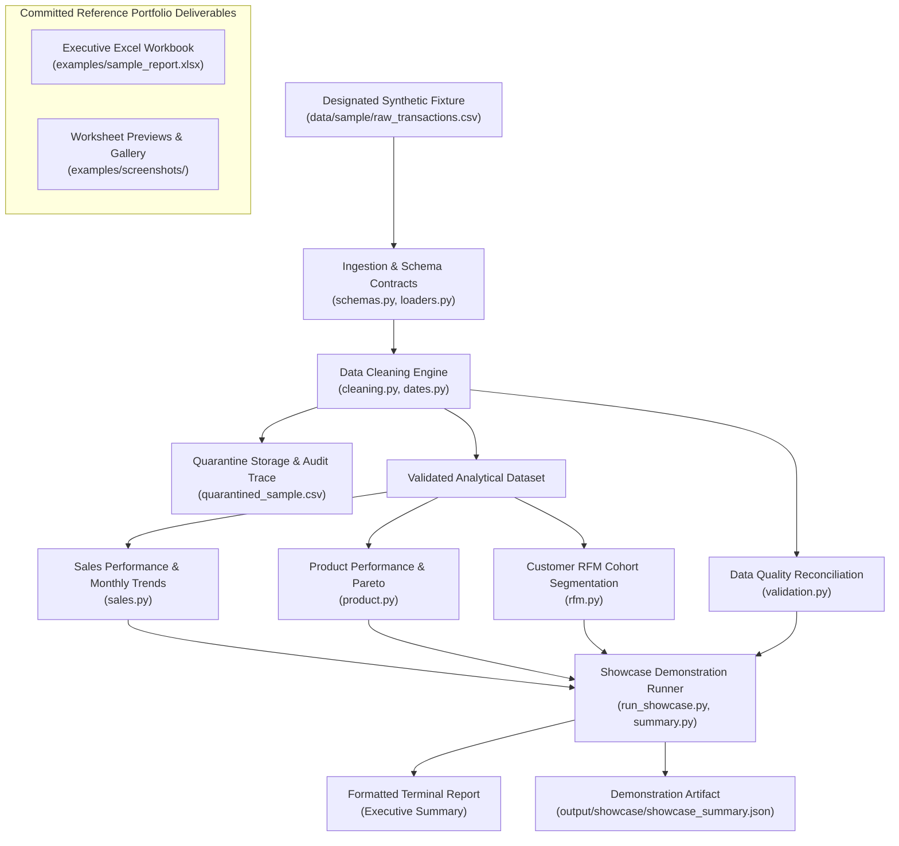
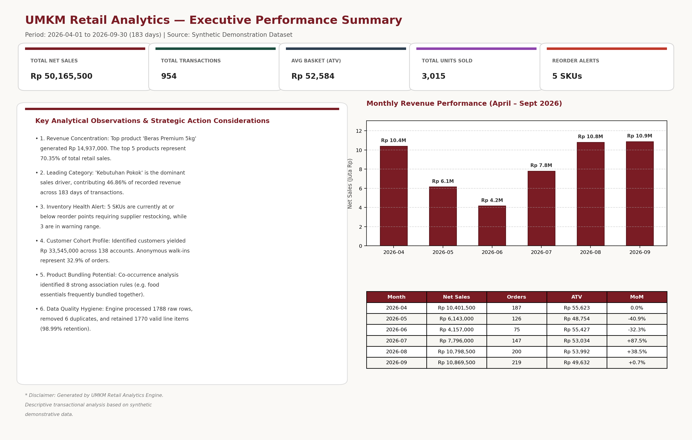
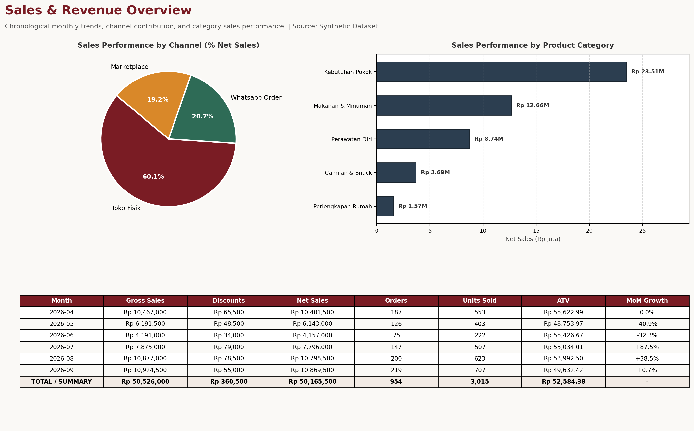
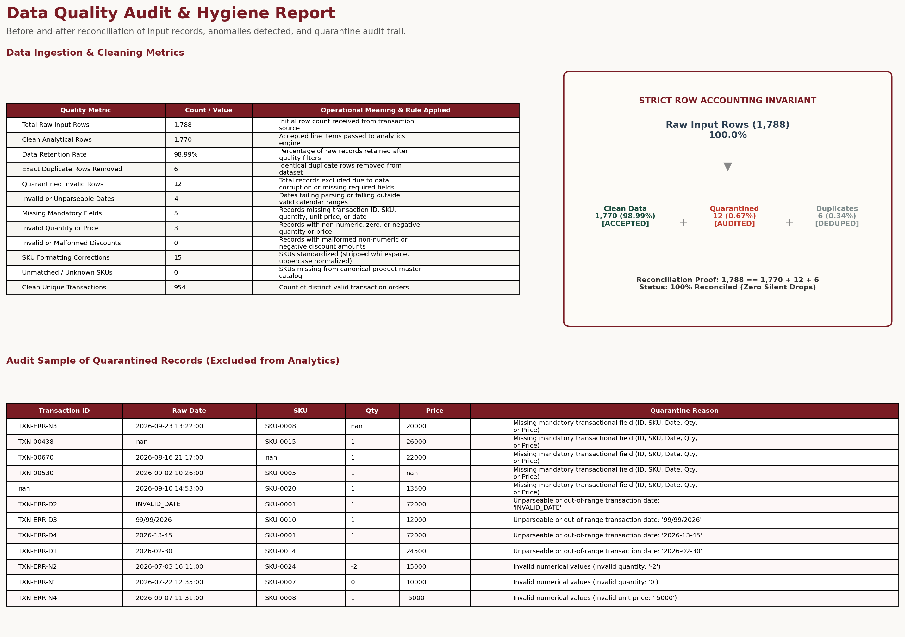

# UMKM Retail Analytics — Technical Showcase

[](https://www.python.org/)
[](tests/)
[](examples/sample_report.xlsx)
[](#13-license-and-reuse-notice)

> **Demonstrating practical Python techniques for retail data quality, business analytics, and reporting.**

---

## 1. Project Overview

The **UMKM Retail Analytics Technical Showcase** is a public portfolio repository illustrating how modern data engineering and retail business analytics principles can be implemented cleanly in Python.

For small and medium retail businesses (UMKM, minimarkets, independent grocers, and specialty shops), transaction logging is often fragmented across Point of Sale (POS) exports, manual cash logs, and messaging channels. Real-world retail exports suffer from dirty formatting, ambiguous timestamps, missing customer identifiers, corrupt numerical values, and duplicate records.

This showcase demonstrates:
1. **Defensive Data Ingestion**: Schema contract enforcement with UTF-8/BOM/Latin-1 encoding resilience.
2. **Deterministic Data Hygiene**: Disambiguating dates (ISO vs. Indonesian slash formatting), validating financial values, and isolating corrupt rows into quarantine storage.
3. **Core Retail Analytics**: Stateless calculation of Sales KPIs, Pareto catalog concentration, customer RFM behavioral cohorts, inventory velocities, and market basket affinities.
4. **Data Accounting Invariant**: Strict verification that every input record is fully reconciled ($\text{Input} = \text{Accepted} + \text{Quarantined} + \text{Duplicates}$).
5. **Reference Executive Deliverable**: A committed, pre-generated 8-sheet Excel workbook ([`examples/sample_report.xlsx`](examples/sample_report.xlsx)) demonstrating client deliverable quality.

---

## 2. The Business Problem Being Demonstrated

Small retail owners make daily purchasing, pricing, and merchandising decisions without clear visibility into their actual sales mechanics:

- **Revenue Ambiguity**: Owners frequently conflate top-line transactional turnover with actual cash flow or gross margins, obscuring whether top-selling items are truly profitable.
- **Product Concentration Blindspots**: High-ticket items (e.g., 5kg Premium Rice, Cooking Oil) generate significant monetary volume, whereas low-ticket items (snacks, instant noodles) generate shelf turnover velocity. Retailers need objective Pareto splits to optimize stock allocation.
- **Customer Retention Opacity**: Retailers often do not know which customers represent stable repeat visits versus high-spending patrons who have lapsed and are at risk of churning.
- **Replenishment Uncertainty**: Without empirical sales run-rate calculations, stores oscillate between stockouts of core staples and overstocking slow-moving catalog tails.

---

## 3. Scope of the Technical Showcase

The scope of this technical portfolio showcase highlights core data engineering and retail analytics practices:

| Audience | Portfolio Purpose |
|---|---|
| **Recruiters, Engineers & Reviewers** | Inspect clean, typed, modular Python code, comprehensive test suites, explicit boundary contracts, and data quality architectures. |
| **Prospective UMKM Clients** | Understand the types of data challenges, analytical methodologies, and executive reporting deliverables that bacadataku addresses through realistic synthetic demonstrations. |

> [!IMPORTANT]
> **Intentional Public Boundaries**:
> - **Synthetic Data Only**: The showcase runner operates strictly on the designated synthetic fixture (`data/sample/raw_transactions.csv`). It does not accept arbitrary external customer files.
> - **Controlled Demonstration Runner**: `scripts/run_showcase.py` (or CLI `retail-analytics`) executes a controlled, representative demonstration that outputs a console summary and writes a lightweight demonstration artifact to `output/showcase/` (git-ignored).
> - **Pre-Generated Reference Deliverable**: The complete, 8-sheet executive Excel workbook is provided as a pre-generated portfolio artifact ([`examples/sample_report.xlsx`](examples/sample_report.xlsx)). The complete eight-sheet workbook generator is not included as a runnable public workflow.
> - **No Overwriting**: Running the demonstration runner will never touch or overwrite [`examples/sample_report.xlsx`](examples/sample_report.xlsx).

---

## 4. High-Level Architecture

The technical showcase enforces clean separation between data boundary validation, data hygiene, pure mathematical analytics, and demonstration reporting:



---

## 5. Selected Engineering Techniques

### A. Deterministic Date Parsing Precedence
Real POS systems in Indonesia output mixed timestamps (e.g. `2026-05-01` alongside `01/05/2026`). Naive parsing with `dayfirst=True` often flips ISO dates (interpreting `2026-05-01` as Jan 5). The engine enforces a deterministic parsing hierarchy:
1. ISO formats (`YYYY-MM-DD`, `YYYY/MM/DD`) are resolved first with strict four-digit year matching.
2. Slash-formatted dates (`DD/MM/YYYY`) are resolved second with `dayfirst=True`.
3. Year boundary validation enforces timestamps between calendar years 2000 and 2050.
4. Ambiguous or unparseable formats are diverted to quarantine storage with clear error tags.

### B. Financial Value Integrity
Financial columns must not silently coerce malformed entries to zero:
- `discount_amount`: Blank or null entries default to `0.0`. Non-empty malformed text (e.g. `"oops"`, `"N/A"`) and negative values are quarantined rather than silently masked.
- `quantity`: Must be strictly positive ($> 0$).
- `unit_price`: Must be non-negative ($\ge 0$).

### C. Strict Row Reconciliation Invariant
The data quality engine verifies that no record is unaccounted for:
$$\text{Input Rows} = \text{Accepted Rows} + \text{Quarantined Rows} + \text{Exact Duplicates}$$
On the bundled synthetic fixture:
$$1,788 = 1,770 + 12 + 6 \quad (\text{Retention Rate: } 98.99\%)$$

### D. Separation of Anonymous Walk-in Transactions
In retail cash registers, transactions often lack registered member IDs. Rather than imputing a dummy customer ID (which would create an artificial "whale" customer), transactions where `customer_id` is missing are segregated as `Unregistered Walk-in` customers.

---

## 6. Synthetic Dataset Description

The bundled synthetic dataset (`data/sample/`) is deterministically generated (`seed=42`) to simulate six months of retail operations (April 1, 2026 to September 30, 2026):

| Fixture File | Scope & Attributes | Rows / Items |
|---|---|---|
| [`raw_transactions.csv`](data/sample/raw_transactions.csv) | Multi-channel retail line items (Store, WhatsApp, Marketplace) with synthetic identifiers (`CUST-0001`, `SKU-0001`, `TXN-0001`), intentional dirty SKUs, exact duplicates, and malformed records. | 1,788 rows |
| [`inventory_snapshot.csv`](data/sample/inventory_snapshot.csv) | Shelf stock levels, unit costs, and reorder thresholds across 30 grocery and FMCG SKUs. | 30 SKUs |
| [`product_master.csv`](data/sample/product_master.csv) | Canonical product catalog with standardized names, categories, default prices, and legacy SKU aliases. | 30 SKUs |

---

## 7. Actual Example Report and Screenshots

A completed, pre-generated reference deliverable is committed in the repository:
- **Excel Deliverable**: [`examples/sample_report.xlsx`](examples/sample_report.xlsx)

The workbook contains **8 structured worksheets**:
1. **`01_EXECUTIVE_SUMMARY`**: 5 high-level KPI cards, Monthly Sales Trend Column Chart, and data-driven executive takeaways.
2. **`02_SALES_OVERVIEW`**: Financial tables with embedded formulas, MoM sales growth, channel split, and Category Contribution Pie Chart.
3. **`03_PRODUCT_ANALYSIS`**: Pareto revenue rankings, volume movers, catalog tail items, and horizontal Bar Chart.
4. **`04_CUSTOMER_RFM`**: Customer RFM scoring roster, cohort distribution, and anonymous walk-in isolation audit.
5. **`05_MARKET_BASKET`**: Frequent item pairs, Support, Confidence, and Lift metrics for bundle merchandising.
6. **`06_INVENTORY`**: Stock velocity, daily run-rate, days of stock remaining, and conditional formatting replenishment alerts.
7. **`07_DATA_QUALITY`**: Data audit metrics, retention rate, and quarantined records log.
8. **`08_RAW_DATA`**: Clean analytical dataset with auto-filters and frozen header row.

### Worksheet Previews Rendered from Sample Report

#### 1. Executive Performance Summary

*Figure 1: Executive performance summary dashboard (Worksheet `01_EXECUTIVE_SUMMARY`), featuring core retail KPI cards, monthly revenue trend chart, and analytical takeaways.*

#### 2. Sales & Category Distribution Analysis

*Figure 2: Sales overview and channel performance (Worksheet `02_SALES_OVERVIEW`), showing channel split (Store, WhatsApp, Marketplace), merchandise category rankings, and chronological financial summary.*

#### 3. Data Quality & Hygiene Audit

*Figure 3: Data quality hygiene audit (Worksheet `07_DATA_QUALITY`), proving the strict reconciliation invariant ($1,788 = 1,770 + 12 + 6$) and displaying the quarantined records audit log.*

For additional details on worksheet structure and resolution, refer to [`examples/screenshots/README.md`](examples/screenshots/README.md).

---

## 8. How to Run the Limited Showcase Demo

### Prerequisites
- Python 3.10, 3.11, or 3.12
- Standard virtual environment tools (`venv` and `pip`)

### Setup Instructions

```bash
# 1. Clone repository (Repository URL will be added after GitHub publication.)
cd umkm-retail-analytics-engine

# 2. Create and activate virtual environment
python3 -m venv .venv
source .venv/bin/activate

# 3. Install dependencies in editable mode
python -m pip install -e .
```

### Running the Showcase Demonstration

Execute the demonstration runner against the bundled synthetic fixture:

```bash
python scripts/run_showcase.py
```

*(Alternatively via installed CLI: `retail-analytics` or `python -m retail_analytics`)*

### Example Console Output

```text
==============================================================================
        UMKM RETAIL ANALYTICS — TECHNICAL PORTFOLIO SHOWCASE
==============================================================================
  Demonstrating Python-based data quality, retail analytics, and reporting.
  Fixture : data/sample/raw_transactions.csv
  Period  : 2026-04-01 to 2026-09-30 (183 days)
------------------------------------------------------------------------------

[1] DATA QUALITY & HYGIENE AUDIT
    Raw Input Records     : 1,788
    Accepted Valid Records: 1,770 (98.99% retention)
    Quarantined Records   : 12 (diverted for audit)
    Exact Duplicates      : 6 (deduplicated)
    Reconciliation Invariant: 1788 == 1770 + 12 + 6 [VERIFIED OK]
    Anomalies Flagged     : Invalid Dates: 4 | Invalid Qty/Price: 3 | Malformed Discounts: 0

[2] SALES PERFORMANCE KPIS (EXECUTIVE SUMMARY)
    Gross Sales Revenue   : Rp 50,526,000
    Total Discounts       : Rp 360,500
    Total Net Sales       : Rp 50,165,500
    Unique Customer Orders: 954 orders
    Average Basket (ATV)  : Rp 52,584
    Total Units Sold      : 3,015 units

[3] TOP 5 REVENUE GENERATING SKUs (PARETO REVENUE DRIVERS)
    1. SKU-0001 - Beras Premium 5kg         : Rp  14,937,000 (29.8% share)
    2. SKU-0002 - Minyak Goreng Sawit 2L    : Rp   7,295,000 (14.5% share)
    3. SKU-0008 - Teh Celup Melati 25s      : Rp   5,349,000 (10.7% share)
    4. SKU-0015 - Shampoo Anti Ketombe 160m : Rp   3,890,000 (7.8% share)
    5. SKU-0014 - Sabun Mandi Cair 450ml    : Rp   3,823,500 (7.6% share)

[4] CUSTOMER RFM BEHAVIORAL COHORTS
    - At Risk           :  37 members ( 33.8% rev) | Spend: Rp 11,332,000
    - Loyal Customers   :  27 members ( 23.5% rev) | Spend: Rp  7,872,500
    - Champions         :  18 members ( 22.5% rev) | Spend: Rp  7,533,000
    - Needs Attention   :  24 members ( 10.2% rev) | Spend: Rp  3,428,000
    - Potential Loyalists:  14 members (  5.2% rev) | Spend: Rp  1,754,000
    - Lost / Inactive   :  18 members (  4.8% rev) | Spend: Rp  1,625,500
    - Unregistered Walk-in : 314 orders  | Revenue: Rp 16,620,500

[5] PORTFOLIO ASSETS & REFERENCE DELIVERABLES
    - Local Artifact Saved: output/showcase/showcase_summary.json (git-ignored)
    - Pre-generated Report: examples/sample_report.xlsx (8-sheet Executive Workbook)
    - Visual Screenshots  : examples/screenshots/README.md
==============================================================================
```

---

## 9. Testing & Quality Assurance

The test suite contains **56 automated unit and integration tests** verifying schema boundaries, parameterless showcase constraints, date parsing, financial validation, analytical formulas, symlink traversal protections, negative safety guards, and deliverable integrity:

```bash
pytest
```

Output:
```text
============================== 56 passed ==============================
```

Test coverage includes:
- **`tests/test_symlink_safety.py`**: Symlinked fixture file rejection, symlinked parent directory rejection, symlinked output directory rejection, SHA-256 fixture manifest integrity verification.
- **`tests/test_dates.py`**: ISO precedence, Indonesian `DD/MM/YYYY` day-first parsing, invalid date quarantine, mixed formats.
- **`tests/test_discounts_and_dq.py`**: Blank discount zero-defaulting, text discount quarantine, negative value quarantine, row reconciliation.
- **`tests/test_safety.py`**: Missing fixture safe failure (no auto-generation), CLI rejection of arbitrary customer input flags, protected directory write guards.
- **`tests/test_showcase.py`**: Showcase execution, deterministic reproducibility, no-overwrite guarantee for `examples/sample_report.xlsx`, workbook validity.
- **`tests/test_ingestion.py`**, **`test_cleaning.py`**, **`test_sales.py`**, **`test_product.py`**, **`test_rfm.py`**, **`test_inventory.py`**, **`test_market_basket.py`**, **`test_validation.py`**.

---

## 10. Methodology & Assumptions

- **Net Sales Definition**: Calculated as $\sum (\text{Qty} \times \text{Price} - \text{Discount})$. Excludes tax withholding and shipping fee adjustments.
- **Pareto Metric**: Independent rankings across monetary net sales and physical units sold.
- **RFM Quintiles**: Quantile-based scoring (1–5) based on empirical percentiles, evaluated against the maximum transaction date in the dataset.
- **Inventory Velocity**: Daily sales run-rate extrapolated linearly: $\text{Units Sold} / \text{Period Days}$.

Detailed formulations are documented in [`docs/methodology.md`](docs/methodology.md).

---

## 11. Known Limitations

- **Descriptive Historical Batching**: The showcase processes static CSV batch snapshots; it does not ingest real-time event streams or connect to live POS hardware.
- **Static Run-Rate Assumption**: Inventory days of stock does not model seasonality, lead time variance, supplier minimum order quantities (MOQ), or promotional spikes.
- **Revenue vs Profit**: Transaction turnover measures top-line recognized sales. It does not reflect gross margin or net cash flow unless wholesale cost (COGS) and expense ledgers are provided.

Comprehensive disclosures are documented in [`docs/limitations.md`](docs/limitations.md).

---

## 12. Privacy and Synthetic-Data Statement

This repository contains **100% synthetic, deterministic data**:
- All transaction identifiers (`TXN-0001`), customer tokens (`CUST-0001`), and product codes (`SKU-0001`) are artificially generated.
- No real customer names, phone numbers, addresses, personal data, or confidential retail business records are contained in this repository.
- No production credentials, API secrets, database connection strings, or internal infrastructure tokens exist in this codebase.

---

## 13. License and Reuse Notice

Copyright © 2026 bacadataku. All rights reserved.

> No open-source license is granted. This repository is published as a technical portfolio showcase. The original code and assets remain under their respective copyright. GitHub users may view and fork the public repository as permitted by GitHub's Terms of Service. No additional permission to reuse, modify, or redistribute the original code is granted through an open-source license.

For professional retail data consulting, customized analytics pipelines, and executive reporting services, please contact [bacadataku](https://bacadataku.com).
