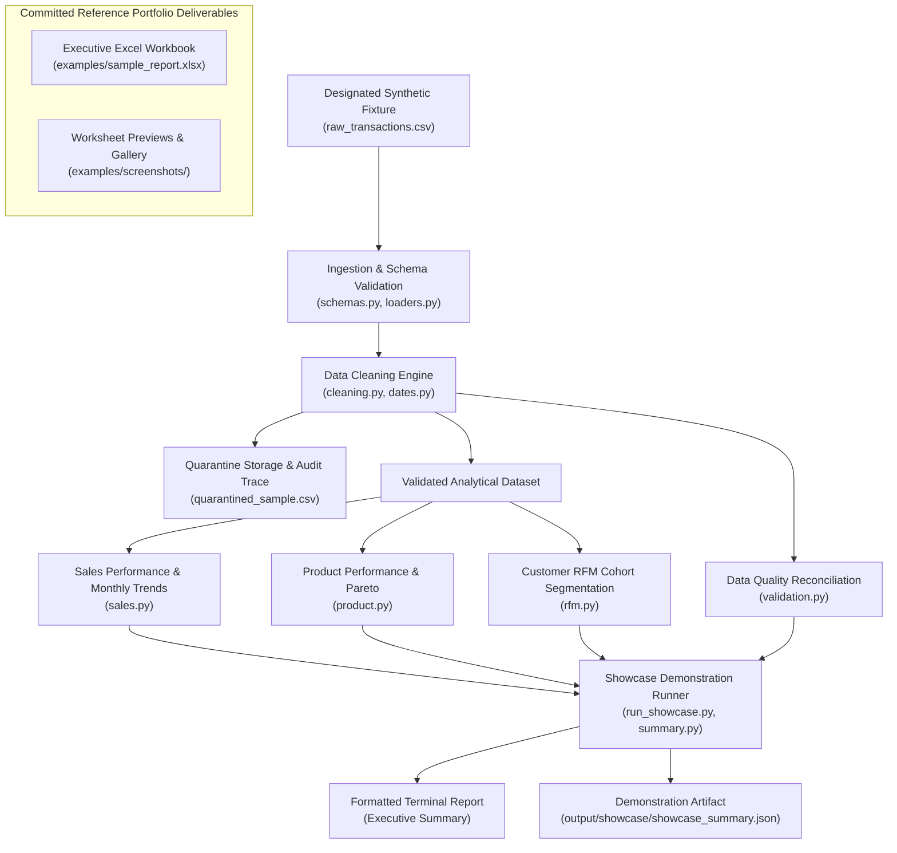

# System Architecture — Technical Showcase

## Overview

The **UMKM Retail Analytics Technical Showcase** demonstrates modular, local-first Python data engineering and retail business analytics. It adheres to clean architecture principles by maintaining a strict decoupling between:

1. **Ingestion & Schema Contracts**: Loading and boundary validation with explicit error halting.
2. **Cleaning & Data Quality Hygiene**: Deterministic date parsing, SKU standardization, invalid record quarantining, and strict row reconciliation.
3. **Pure Business Analytics**: Stateless calculations operating exclusively on Pandas DataFrames (Sales KPIs, Pareto product rankings, RFM customer cohorts, inventory velocity, and market basket co-occurrence).
4. **Controlled Showcase Runner**: Console reporting and lightweight demonstration artifacts (`output/showcase/showcase_summary.json`).
5. **Reference Executive Deliverable**: Committed demonstration artifact (`examples/sample_report.xlsx`) showcasing final business reporting capabilities as a pre-generated portfolio deliverable.

---

## Architectural Layers

### 1. Ingestion Layer (`src/retail_analytics/ingestion/`)
- **`schemas.py`**: Defines mandatory contracts (`TRANSACTION_REQUIRED_COLUMNS`, `INVENTORY_REQUIRED_COLUMNS`). Custom exception `SchemaValidationError` halts execution immediately if core identifiers or metrics are missing.
- **`loaders.py`**: Handles character encodings (`utf-8-sig`, `utf-8`, `latin-1`), strips whitespace from header tokens, and populates missing optional attributes with sensible defaults.

### 2. Cleaning & Quality Layer (`src/retail_analytics/cleaning/`)
- **`dates.py`**: Multi-format deterministic date parsing with strict precedence: ISO formats (`YYYY-MM-DD`) first, followed by Indonesian slash format (`DD/MM/YYYY`) with `dayfirst=True`, bounded within calendar years 2000–2050. Ambiguous or out-of-range dates are rejected.
- **`cleaning.py`**: Executes deterministic hygiene steps:
  - Exact duplicate elimination without dropping valid multi-line transactions.
  - Positive numeric coercion for units and selling prices.
  - Financial discount validation: empty values default to 0.0, while malformed text and negative values are quarantined.
  - SKU standardization (trimming, casing) and alias resolution via `product_master.csv`.
  - Quarantine segregation: corrupted rows are quarantined with descriptive reasons.
- **`validation.py`**: Captures before-and-after row metrics and guarantees the strict reconciliation invariant:
  $$\text{Input Rows} = \text{Output Rows} + \text{Quarantined Rows} + \text{Exact Duplicates}$$

### 3. Analytics Layer (`src/retail_analytics/analytics/`)
Pure, stateless Python and Pandas calculations:
- **`sales.py`**: Gross sales, discounts, net sales, unique order counts, and Average Transaction Value (ATV).
- **`product.py`**: Volume vs value rankings, revenue contribution percentages, and catalog concentration.
- **`rfm.py`**: Recency, Frequency, and Monetary spend scored into quintiles (1–5) with explicit separation of unregistered walk-in transactions.
- **`inventory.py`**: Empirical daily run-rate velocity, estimated days of stock remaining, and reorder urgency alerts.
- **`market_basket.py`**: Item co-occurrence yielding Support, Confidence, and Lift ratios.

### 4. Showcase Demonstration Layer (`src/retail_analytics/showcase/` & `scripts/`)
- **`summary.py` / `scripts/run_showcase.py`**: Orchestrates the controlled technical showcase on the designated synthetic dataset, prints a structured terminal summary, and saves lightweight summary artifacts to `output/showcase/`.
- **Protected Deliverables Guard**: Verifies that demonstration outputs never overwrite committed portfolio assets (`examples/sample_report.xlsx`).

---

## Design Principles

- **Local-First & Offline**: 100% reproducible in offline environments without external cloud services.
- **Strict Data Accounting**: Quarantined records are isolated and audited; they are never combined with accepted analytical records.
- **Deterministic Output**: Fixed seeds (`seed=42`) guarantee reproducible synthetic generation and analytics.
- **Focused Portfolio Scope**: Demonstrates data engineering capability through focused representative modules and committed reference deliverables, rather than functioning as a turnkey general-purpose analytics product.
